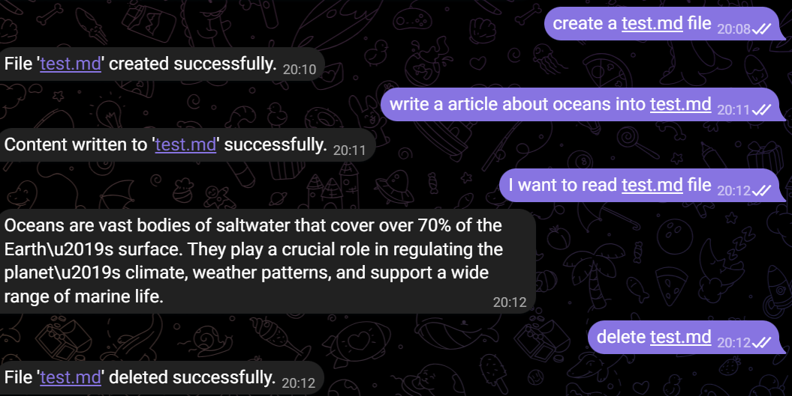

MeClaw
======

Overview
--------
MeClaw is a software project repository designed to support the development of a Telegram-based assistant that can interact with files and perform basic operations through a local workflow. The project is currently under active development and is being expanded in a structured and maintainable manner.

Project Status
--------------
The repository is being developed continuously. Current functionality includes a Telegram bot interface, local file management tools, and integration with an Ollama-based language model. Additional features and improved workflows are expected to be added over time.

How It Works
------------
The application is executed locally through the Python entry point in server.py. The bot receives user messages from Telegram, processes them, and can trigger file operations such as creating, reading, copying, writing, and deleting files. The underlying file operations are implemented in tools/explorer.py and are directed to the tools/testdir directory.

Where It Runs
-------------
The application is intended to run on a local development environment with Python installed. It communicates with Telegram via the Telegram Bot API and uses Ollama as the language model backend. In practical use, the system runs on the machine where the Python process is launched and where the required dependencies are installed.

Installation and Setup
----------------------
1. Clone or download the repository.
2. Install the required Python packages:
   pip install -r requirements.txt
3. Ensure that Ollama is installed and running locally.
4. Configure the Telegram bot token in the environment variables, using the variable TELEGRAM_API.
5. Start the application:
   python server.py

How to Use It
-------------
Once the application is running, the bot can be used through Telegram. Users may interact with the bot directly, and the system can respond to natural language requests while performing supported file operations. The currently available commands include:

- /start
- /tools
- /create_file
- /delete_file
- /copy_file
- /read_file
- /write_file

Example Usage Scenario
----------------------
A typical usage scenario involves a user sending a message to the bot such as "Create a file named notes.txt" or "Read the content of poem.txt". The bot processes the request, performs the relevant file action in the local tools/testdir folder, and returns a confirmation or the requested content to the user.

Example visualization:

Development Notes
-----------------
This project is still in development and may evolve as new capabilities are added. The current implementation focuses on establishing a reliable local interface for bot-driven file operations and conversational interaction.

License
-------
No license has been specified yet.
